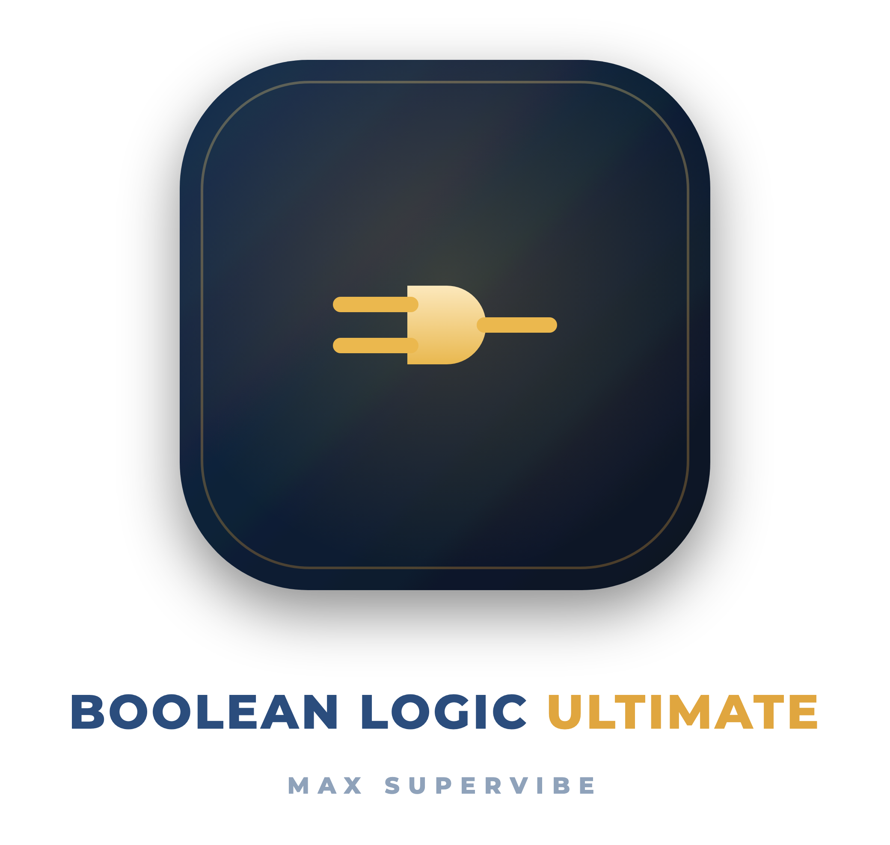

<p align="center">
  
</p>

# Boolean Logic Ultimate

A collection of enhanced logic and utility nodes for Node-RED. It supports persistent values after reboot and conversion of common Home Assistant values.

[![NPM version][npm-version-image]][npm-url]
[![NPM downloads per month][npm-downloads-month-image]][npm-url]
[![NPM downloads total][npm-downloads-total-image]][npm-url]
[![MIT License][license-image]][license-url]
[](https://standardjs.com)
[](https://www.paypal.me/techtoday)
[![youtube][youtube-image]][youtube-url]
[](https://www.maxsupervibe.com)

<p align="center">
  
</p>

## Getting started

Install the package from the Node-RED palette manager or run this command in your Node-RED user directory:

```shell
npm install node-red-contrib-boolean-logic-ultimate
```

Importable flows are available from the Node-RED editor under **Menu (☰) → Import → Examples**, or directly in the [`examples/`](examples/) folder. See the [examples overview](examples/README.md) for the complete list.

## 📘 Documentation

The full documentation is on **[maxsupervibe.com](https://www.maxsupervibe.com/docs/boolean-logic-ultimate/)**, together with the help of every other Max Supervibe node.

<p align="left" style="font-size:2.25rem;font-weight:700;line-height:1.9;">
  <a href="https://www.maxsupervibe.com/docs/boolean-logic-ultimate/">📘 Go to the documentation</a>
</p>

Release notes: [CHANGELOG.md](CHANGELOG.md)

[license-image]: https://img.shields.io/badge/license-MIT-blue.svg
[license-url]: https://github.com/Supergiovane/node-red-contrib-boolean-logic-ultimate/master/LICENSE
[npm-url]: https://npmjs.org/package/node-red-contrib-boolean-logic-ultimate
[npm-version-image]: https://img.shields.io/npm/v/node-red-contrib-boolean-logic-ultimate.svg
[npm-downloads-month-image]: https://img.shields.io/npm/dm/node-red-contrib-boolean-logic-ultimate.svg
[npm-downloads-total-image]: https://img.shields.io/npm/dt/node-red-contrib-boolean-logic-ultimate.svg
[youtube-image]: https://img.shields.io/badge/Visit%20me-youtube-red
[youtube-url]: https://youtube.com/playlist?list=PL9Yh1bjbLAYoRH4IyQB7EL5srHAihiKpy
